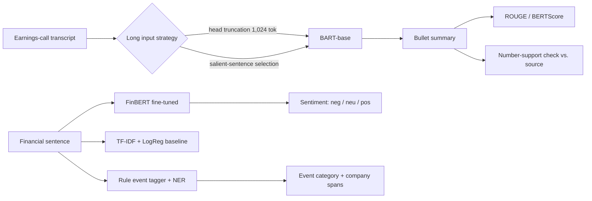

<div align="center">

# Financial News NLP: Summarization, Sentiment, and Event Extraction

**BART-base earnings-call summaries, FinBERT sentence sentiment, and a rule-based financial event tagger, with factuality checks that ROUGE misses.**

     

</div>

## What this is

A graduate NLP project (CIS 511, University of Michigan-Dearborn, Fall 2026, Team BART Street) that builds a two-stage pipeline for financial text:

1. **Summarize** an earnings-call transcript into wire-style bullets (ECTSum, BART-base).
2. **Extract** structured signals from financial sentences: sentiment (Financial PhraseBank, FinBERT), financial events, and company entities.

The angle that matters: a summarizer can score well on ROUGE while inventing the numbers a reader would act on. Every summarization result here is reported next to a **number-support check** that asks whether each generated figure actually appears in the source call.

## Pipeline



## Datasets

| Dataset | Task | Split used | Notes |
|---|---|---|---|
| [ECTSum](https://github.com/rajdeep345/ECTSum) | abstractive summarization | released 1681 / 249 / 495 | transcripts average 2842 words; 0.9761 exceed BART's 1,024-token window |
| [Financial PhraseBank](https://huggingface.co/datasets/takala/financial_phrasebank) | 3-class sentence sentiment | 75% agreement subset, stratified seed-42 split 2758 / 345 / 345 | 5 duplicates removed; neutral is about 62% of every split, so macro-F1 is the headline metric |
| FiQA 2018 headlines | held-out sentiment check | 436 headlines (pos 208 / neu 121 / neg 107) | scores thresholded at ±0.2; never seen by any model here |

The PhraseBank split indices are committed in `data/fpb/split_seed42.json`; every script reads that file, so all experiments share the same test sentences.

## Summarization results (ECTSum test, 495 calls)

ROUGE F1 x 100 with stemming. BERTScore F1 uses roberta-large without rescaling. *Unsupported* = share of summaries containing at least one number (after format normalisation) that does not occur anywhere in the transcript.

| System | R-1 | R-2 | R-L | BERTScore | Words | Unsupported |
|---|---|---|---|---|---|---|
| Lead-4 | 9.36 | 1.6 | 6.57 | - | - | - |
| TF-IDF top-4 sentences | 7.98 | 0.62 | 5.51 | - | - | - |
| BART-base, head truncation, 2 epochs | 32.09 | 17.77 | 28.15 | 0.8698 | 21.5 | 76% |
| BART-base, head truncation, 3 epochs | 32.49 | 18.13 | 28.31 | - | 23.5 | 80% |
| BART-base, head truncation, tuned decoding (min 48 tokens) | 33.5 | 16.58 | 27.36 | 0.8669 | 32.9 | 95% |
| **BART-base, salient-sentence input, 2 epochs** | 36.26 | 23.58 | 32.34 | 0.8768 | 19.3 | 53% |

> **Finding.** Selecting salient sentences (TF-IDF similarity to the training references, 760-word budget) instead of truncating the head of the call raised ROUGE-L from 28.15 to 32.34 *and* cut the share of summaries with an invented number from 76% to 53%. The numbers the references care about often sit past the first 1,024 tokens.

<details><summary>Decoding grid (validation, 100 docs): longer outputs raise ROUGE-1 and lower ROUGE-2</summary>

| min new tokens | length penalty | R-1 | R-2 | R-L | words |
|---|---|---|---|---|---|
| 16 | 1.0 | 31.48 | 17.82 | 28.16 | 22.2 |
| 16 | 1.5 | 33.08 | 17.69 | 28.51 | 26.4 |
| 16 | 2.0 | 33.77 | 17.27 | 28.41 | 31.7 |
| 32 | 1.0 | 32.37 | 17.58 | 28.26 | 25.1 |
| 32 | 1.5 | 33.52 | 17.5 | 28.35 | 28.8 |
| 32 | 2.0 | 34.04 | 17.02 | 28.3 | 34.0 |
| 48 | 1.0 | 34.44 | 17.53 | 28.7 | 33.6 |
| 48 | 1.5 | 34.61 | 17.09 | 28.12 | 38.0 |
| 48 | 2.0 | 34.67 | 16.43 | 27.47 | 42.9 |
| 64 | 1.0 | 34.9 | 16.65 | 27.53 | 42.9 |
| 64 | 1.5 | 34.91 | 16.29 | 27.04 | 47.4 |
| 64 | 2.0 | 34.79 | 15.96 | 26.72 | 51.2 |

</details>

## Sentiment results (Financial PhraseBank test, 345 sentences)

| Model | Accuracy | Macro-F1 | F1 neg | F1 neu | F1 pos |
|---|---|---|---|---|---|
| Majority class (neutral) | 0.6203 | 0.2552 | 0.00 | 0.77 | 0.00 |
| TF-IDF 1-2gram + logistic regression | 0.864 | 0.807 | 0.72 | 0.91 | 0.79 |
| FinBERT released head (ProsusAI/finbert, trained on PhraseBank by its authors) | 0.954 | 0.945 | 0.94 | 0.97 | 0.92 |
| **FinBERT fine-tuned on our split, mean of 3 seeds** | **0.956** (0.942 to 0.965) | **0.947** (0.936 to 0.954) | 0.95 | 0.97 | 0.92 |

> **Caveat.** The released FinBERT checkpoint was itself fine-tuned on Financial PhraseBank, so its row is not a clean held-out number. The TF-IDF model is the honest baseline; the fine-tuned model on our own split is the main result.

### Held-out check on FiQA headlines (never seen by any model)

| Model | Accuracy | Macro-F1 |
|---|---|---|
| TF-IDF + logistic regression | 0.429 | 0.392 |
| FinBERT released head | 0.667 | 0.674 |
| FinBERT fine-tuned on our PhraseBank split | 0.576 | 0.598 |

> Out of domain everything drops hard. The finance-adapted encoder still beats the lexical baseline by about 20 macro-F1 points, but fine-tuning on PhraseBank taught the model a strong *neutral* prior that mislabels short opinionated headlines. The in-domain 0.95 does not travel.

## Events and entities (PhraseBank test, 345 sentences)

A six-category rule tagger (earnings result, guidance, acquisition or merger, financing or share issue, contract or order, management change) plus `dslim/bert-base-NER` for company spans. No gold event labels exist in the dataset, so the tagger is measured by coverage and by a manual precision review.

| Category | Sentences tagged |
|---|---|
| earnings result | 82 |
| contract order | 45 |
| guidance | 35 |
| acquisition merger | 10 |
| financing share issue | 7 |
| management change | 6 |

Tagger fires on 171 of 345 sentences; NER finds an organisation in 189. Manual review of 53 tagged sentences gives precision 0.57 overall (0.86 financing, 0.80 acquisition, 0.70 earnings, 0.40 contract and guidance, 0.17 management change); estimated recall 0.71.

## Repository layout

```text
src/
  ectsum_stats_baseline.py   ECTSum statistics, Lead-4 and TF-IDF baselines, ROUGE harness
  fpb_download.py            Financial PhraseBank download (Hugging Face mirror)
  fpb_stats_baseline.py      PhraseBank statistics, seed-42 split, majority and TF-IDF baselines
  fpb_finbert.py             FinBERT released-head evaluation and fine-tuning
  ectsum_bart.py             BART-base fine-tuning with head truncation, ROUGE + BERTScore
  event_rules.py             rule-based event tagger + NER coverage
  factual_check.py           normalised number-support check of summaries against transcripts
  ectsum_bart_v2.py          long-input (salient sentences) and decoding ablations
  fpb_heldout_fiqa.py        FiQA headline held-out check for all sentiment models
results/                     one JSON (and prediction file) per experiment; every number above comes from here
tools/build_readme.py        regenerates this README from results/
```

## Reproduce

```bash
pip install -r requirements.txt
# data
git clone https://github.com/rajdeep345/ECTSum data/ectsum/ECTSum
python src/fpb_download.py data/fpb
# statistics and baselines
python src/ectsum_stats_baseline.py data/ectsum/ECTSum/data/final results
python src/fpb_stats_baseline.py data/fpb results
python src/fpb_finbert.py data/fpb results runs --epochs 3            # about 1 min on an 8 GB laptop GPU
python src/ectsum_bart.py data/ectsum/ECTSum/data/final results runs --epochs 2 --bertscore   # about 6 min
python src/ectsum_bart_v2.py data/ectsum/ECTSum/data/final results runs --tag salient --select salient --epochs 2 --bertscore
python src/factual_check.py results/ectsum_bart_test_preds.json data/ectsum/ECTSum/data/final/test/ects results/factual_check_head.json
python src/event_rules.py data/fpb results
python src/fpb_heldout_fiqa.py data/fpb data/fiqa runs results
python tools/build_readme.py
```

All seeds are fixed at 42. Model weights are written to `runs/` and are not committed; every configuration retrains in under 15 minutes on one RTX 5060 laptop GPU.

## Progress log

| Date | Milestone |
|---|---|
| 2026-11-22 | Dataset statistics, saved PhraseBank split, and extractive and lexical baselines for ECTSum and Financial PhraseBank |
| 2026-11-22 | Fine-tune FinBERT on the seed-42 PhraseBank split |
| 2026-11-22 | Fine-tune BART-base on ECTSum with head truncation |
| 2026-11-23 | Add rule-based financial event tagger and NER coverage on the PhraseBank test split |
| 2026-11-25 | Add normalised number-support check for generated summaries |
| 2026-11-26 | Long-input and decoding ablations: salient-sentence input halves unsupported numbers |
| 2026-11-27 | Seed robustness and FiQA held-out check for the sentiment models |

## Team

Team BART Street, CIS 511 Graduate Natural Language Processing, Fall 2026: Raima Arif, Sudarshan Sridhar, Firas Abueida.

## Licences

Code in this repository is MIT. ECTSum is GPL-3.0, Financial PhraseBank is CC BY-NC-SA 3.0 (non-commercial), FiQA is a public research release, and the pretrained checkpoints carry their own Hugging Face licences. Cite the original authors if you use any of them.
