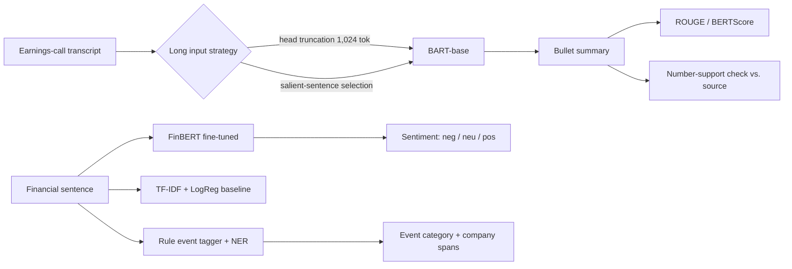

<div align="center">

# Financial News NLP: Summarization, Sentiment, and Event Extraction

**BART-base earnings-call summaries, FinBERT sentence sentiment, and a rule-based financial event tagger, with factuality checks that ROUGE misses.**

     

</div>

## What this is

A graduate NLP project (CIS 511, University of Michigan-Dearborn, Fall 2026, Team BART Street) that builds a two-stage pipeline for financial text:

1. **Summarize** an earnings-call transcript into wire-style bullets (ECTSum, BART-base).
2. **Extract** structured signals from financial sentences: sentiment (Financial PhraseBank, FinBERT), financial events, and company entities.

The angle that matters: a summarizer can score well on ROUGE while inventing the numbers a reader would act on. Every summarization result here is reported next to a **number-support check** that asks whether each generated figure actually appears in the source call.

## Pipeline



## Datasets

| Dataset | Task | Split used | Notes |
|---|---|---|---|
| [ECTSum](https://github.com/rajdeep345/ECTSum) | abstractive summarization | released 1681 / 249 / 495 | transcripts average 2842 words; 0.9761 exceed BART's 1,024-token window |
| [Financial PhraseBank](https://huggingface.co/datasets/takala/financial_phrasebank) | 3-class sentence sentiment | 75% agreement subset, stratified seed-42 split 2758 / 345 / 345 | 5 duplicates removed; neutral is about 62% of every split, so macro-F1 is the headline metric |

The PhraseBank split indices are committed in `data/fpb/split_seed42.json`; every script reads that file, so all experiments share the same test sentences.

## Summarization results (ECTSum test, 495 calls)

ROUGE F1 x 100 with stemming. BERTScore F1 uses roberta-large without rescaling. *Unsupported* = share of summaries containing at least one number (after format normalisation) that does not occur anywhere in the transcript.

| System | R-1 | R-2 | R-L | BERTScore | Words | Unsupported |
|---|---|---|---|---|---|---|
| Lead-4 | 9.36 | 1.6 | 6.57 | - | - | - |
| TF-IDF top-4 sentences | 7.98 | 0.62 | 5.51 | - | - | - |

## Sentiment results (Financial PhraseBank test, 345 sentences)

| Model | Accuracy | Macro-F1 | F1 neg | F1 neu | F1 pos |
|---|---|---|---|---|---|
| Majority class (neutral) | 0.6203 | 0.2552 | 0.00 | 0.77 | 0.00 |
| TF-IDF 1-2gram + logistic regression | 0.864 | 0.807 | 0.72 | 0.91 | 0.79 |
| FinBERT released head (ProsusAI/finbert, trained on PhraseBank by its authors) | 0.954 | 0.945 | 0.94 | 0.97 | 0.92 |
| **FinBERT fine-tuned on our split** | **0.965** | **0.952** | 0.94 | 0.98 | 0.93 |

> **Caveat.** The released FinBERT checkpoint was itself fine-tuned on Financial PhraseBank, so its row is not a clean held-out number. The TF-IDF model is the honest baseline; the fine-tuned model on our own split is the main result.

## Repository layout

```text
src/
  ectsum_stats_baseline.py   ECTSum statistics, Lead-4 and TF-IDF baselines, ROUGE harness
  fpb_download.py            Financial PhraseBank download (Hugging Face mirror)
  fpb_stats_baseline.py      PhraseBank statistics, seed-42 split, majority and TF-IDF baselines
  fpb_finbert.py             FinBERT released-head evaluation and fine-tuning
results/                     one JSON (and prediction file) per experiment; every number above comes from here
tools/build_readme.py        regenerates this README from results/
```

## Reproduce

```bash
pip install -r requirements.txt
# data
git clone https://github.com/rajdeep345/ECTSum data/ectsum/ECTSum
python src/fpb_download.py data/fpb
# statistics and baselines
python src/ectsum_stats_baseline.py data/ectsum/ECTSum/data/final results
python src/fpb_stats_baseline.py data/fpb results
python src/fpb_finbert.py data/fpb results runs --epochs 3            # about 1 min on an 8 GB laptop GPU
python tools/build_readme.py
```

All seeds are fixed at 42. Model weights are written to `runs/` and are not committed; every configuration retrains in under 15 minutes on one RTX 5060 laptop GPU.

## Progress log

| Date | Milestone |
|---|---|
| 2026-11-22 | Dataset statistics, saved PhraseBank split, and extractive and lexical baselines for ECTSum and Financial PhraseBank |
| 2026-11-22 | Fine-tune FinBERT on the seed-42 PhraseBank split |

## Team

Team BART Street, CIS 511 Graduate Natural Language Processing, Fall 2026: Raima Arif, Sudarshan Sridhar, Firas Abueida.

## Licences

Code in this repository is MIT. ECTSum is GPL-3.0, Financial PhraseBank is CC BY-NC-SA 3.0 (non-commercial), FiQA is a public research release, and the pretrained checkpoints carry their own Hugging Face licences. Cite the original authors if you use any of them.
